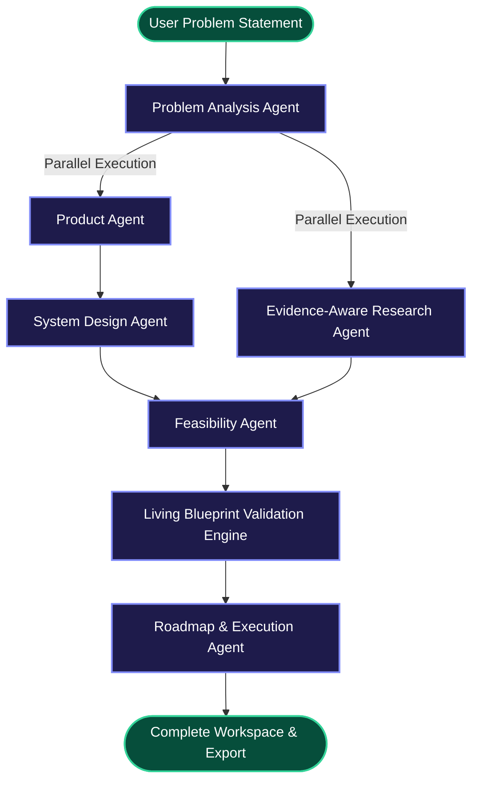

# ATHENA: Agentic AI-Based Automated Product Planning & System Design Platform

ATHENA is an enterprise-grade agentic pair-planning platform that transforms raw, unstructured problem statements into comprehensive product specifications, living validation audits, and interactive system architecture diagrams. Powered by **FastAPI**, **LangGraph**, **React Flow**, and **Next.js 16**.

---

## 🏗️ System DAG Architecture

The orchestrator utilizes an asynchronous parallel-join Directed Acyclic Graph (DAG) state machine with built-in token budget enforcement and live validation:



---

## 🛠️ Specialized Agents & Engine Suite

ATHENA coordinates 6 specialized agents and a deterministic validation engine:

1. **Problem Analysis Agent** (`app/agents/problem_analysis_agent.py`):
   - Decomposes problem complexity, target personas, core objectives, assumptions, and constraints.
   - Implements SHA-256 decomposition caching (Redis / memory fallback) with a 24-hour TTL.
2. **Product Agent** (`app/agents/product_agent.py`):
   - Generates vision statements, personas, functional requirements (`REQ-xxx`), and epic features (`F-xxx`).
3. **Evidence-Aware Research Agent** (`app/agents/research_agent.py`):
   - Maps competitors, market gaps, and differentiation strategies.
   - Grounded with live DuckDuckGo web search research and verified evidence claims.
4. **System Design Agent** (`app/agents/system_design_agent.py`):
   - Produces High-Level Design (HLD) documentation and structured React Flow canvas JSON (nodes, edges, positions).
5. **Feasibility Agent** (`app/agents/feasibility_agent.py`):
   - Evaluates technical risk matrices, timeline estimations, and resource/skill bottlenecks.
6. **Living Blueprint Validation Engine** (`app/agents/validation_engine.py`):
   - Audits requirement-to-feature coverage, identifies orphaned components, checks unverified evidence claims, and powers the interactive **"Break My Plan"** challenge engine.
7. **Roadmap & Execution Agent** (`app/agents/roadmap_agent.py`):
   - Constructs phased delivery milestones (MVP Scope vs. V2 Scope).

---

## ✨ Key Features

- **Asynchronous Parallel DAG**: Concurrently executes `ProductAgent` and `ResearchAgent` using worker thread pooling.
- **Interactive Architecture Canvas**: Editable React Flow diagram supporting drag-and-drop, zoom/pan, custom component shapes, and edge reconnecting.
- **Living Blueprint Dashboard**: Real-time coverage health indicators, critical risk flags, and interactive technology decision challenge.
- **Export Capabilities**:
  - One-click **Standalone Vector SVG Diagram** download (`GET /api/projects/{id}/canvas/export`).
  - Full **ZIP Project Bundle** export containing markdown specifications for all agents, canvas JSON data, and SVG diagrams (`GET /api/projects/{id}/export`).
- **Cost & Concurrency Controls**:
  - Hard **50,000-token budget cap** per execution run.
  - Concurrency rate limiter enforcing a maximum of **3 concurrent pipeline runs** per user (HTTP 429).
- **Flexible LLM Runtime**:
  - Supports **Local Ollama** (`llama3.2:1b`), **Google Gemini** (`gemini-1.5-flash`), **OpenAI** (`gpt-4o`), and resilient offline fallback synthesis.
- **Local RAG Specs Ingestion**: Ingest custom PRD/documentation chunks and search contextual vectors directly from the workspace.

---

## 🚀 Getting Started

### 📋 Prerequisites
- [Python 3.11+](https://www.python.org/)
- [Node.js v20+](https://nodejs.org/)
- [Ollama](https://ollama.com/) (Optional for local-first inference)
- [Docker Desktop](https://www.docker.com/) (Optional for containerized run)

---

### Local Development Setup

#### 1. Configure Environment Variables
Copy `.env.example` to `.env`:
```bash
cp .env.example .env
```
Key settings in `.env`:
```env
ENV=development
PROJECT_NAME="ATHENA Platform"
API_V1_STR=/api
DEV_MODE=True

# LLM Configuration (hybrid, local, or cloud)
LLM_MODE=hybrid
OLLAMA_BASE_URL=http://localhost:11434
OLLAMA_MODEL=llama3.2:1b

# Cloud API Keys (optional if using local Ollama or fallback)
GEMINI_API_KEY=
OPENAI_API_KEY=

# Local Database & Cache
DATABASE_URL=sqlite:///./product_planner.db
REDIS_URL=redis://localhost:6379/0

# Supabase Auth
SUPABASE_URL=https://your-project.supabase.co/
SUPABASE_JWT_SECRET=your-secret
NEXT_PUBLIC_SUPABASE_URL=https://your-project.supabase.co/
NEXT_PUBLIC_SUPABASE_ANON_KEY=your-anon-key
```

#### 2. Start Backend API
```powershell
cd backend
python -m venv venv
.\venv\Scripts\activate
pip install -r requirements.txt
alembic upgrade head
uvicorn app.main:app --host 127.0.0.1 --port 8000 --reload
```
API Documentation: [http://localhost:8000/docs](http://localhost:8000/docs)

#### 3. Start Frontend Client
```powershell
cd frontend
npm install
npm run dev
```
Workspace UI: [http://localhost:3000](http://localhost:3000)

---

### Docker Compose Execution

To launch the complete containerized stack (PostgreSQL, Redis, Celery Worker, FastAPI, and Next.js):
```bash
docker-compose up -d --build
docker-compose exec api alembic upgrade head
```

---

## 🧪 Running Tests

Execute the backend automated test suite:
```powershell
cd backend
.\venv\Scripts\python.exe -m unittest discover -s tests -p "test_*.py"
```

Verify frontend production build:
```powershell
cd frontend
npm run build
```

---

## 🗂️ Project Directory Structure

```
.
├── backend/
│   ├── alembic/                    # Database migrations (PostgreSQL & SQLite)
│   ├── app/
│   │   ├── agents/                 # Specialized agents (Problem Analysis, Product, Design, etc.)
│   │   ├── api/                    # REST endpoints (Projects, Pages, Canvas, Graph)
│   │   ├── core/                   # Config, DB engine, security & model provider
│   │   ├── graph/                  # LangGraph DAG pipeline & state definitions
│   │   ├── models/                 # SQLAlchemy relational & graph schema models
│   │   ├── schemas/                # Pydantic validation schemas
│   │   └── workers/                # Celery & background worker tasks
│   ├── requirements.txt            # Python dependencies
│   └── tests/                      # Automated unit test suite
├── frontend/
│   ├── app/                        # Next.js 16 App Router (Dashboard, Canvas, Notion editor)
│   │   ├── components/             # React Flow Canvas, HealthDashboard, Workspaces
│   │   ├── login/ & signup/        # Authentication screens
│   │   └── project/[id]/           # Dynamic project workspace routes
│   └── package.json                # Frontend dependencies
├── docker-compose.yml              # Multi-container orchestration
└── implementation_blueprint.md     # Technical specification & system design
```

---

## 📄 License

MIT License. Designed and built for automated product planning and systems engineering.
